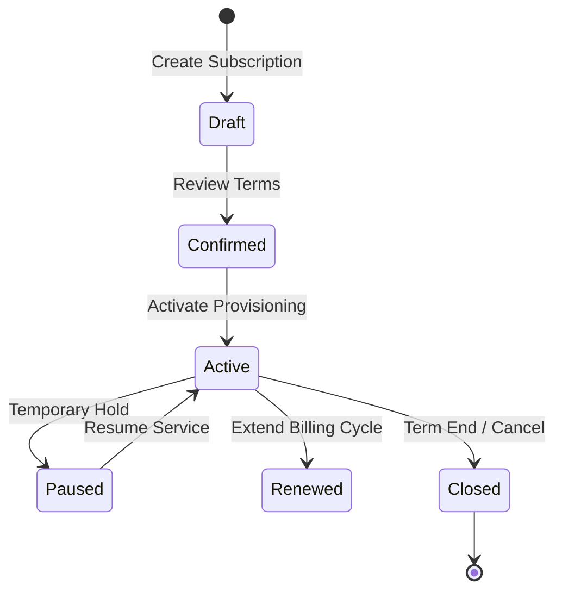

# BillSync – Subscription Management System

  

  <strong>An all-in-one recurring billing, subscription lifecycle, and invoice management platform for modern businesses.</strong>

  
  
  
  
  
  

---

## 📌 What is BillSync?

Businesses that sell software, memberships, or services struggle with managing spreadsheets, tracking renewals, calculating overdue bills, and recording partial payments.

**BillSync solves this by unifying the entire billing lifecycle into a single web application.** From customer onboarding and quotation approvals to recurring subscription management, automated invoicing, and real-time payment reconciliation.

---

## 🔄 End-to-End Business Flow

The entire workflow from a new customer to received payment is fully automated and interconnected:

```mermaid
flowchart LR
    classDef setup fill:#eff6ff,stroke:#3b82f6,stroke-width:2px,color:#1e40af;
    classDef sales fill:#f5f3ff,stroke:#8b5cf6,stroke-width:2px,color:#5b21b6;
    classDef billing fill:#ecfdf5,stroke:#10b981,stroke-width:2px,color:#065f46;
    classDef payment fill:#fffbeb,stroke:#f59e0b,stroke-width:2px,color:#92400e;

    subgraph Step1["1. Setup & Catalog"]
        A["👤 Add Customer"]:::setup --> B["📦 Add Products & Plans"]:::setup
    end

    subgraph Step2["2. Sales Agreement"]
        B --> C["📝 Create Quotation"]:::sales
        C --> D["✅ Confirm Quotation"]:::sales
    end

    subgraph Step3["3. Subscription & Billing"]
        D --> E["🔁 Activate Subscription"]:::billing
        E --> F["📄 Generate Invoice"]:::billing
    end

    subgraph Step4["4. Payment & Insights"]
        F --> G["💳 Record Payment"]:::payment
        G --> H["⚡ Real-Time Dashboard"]:::payment
    end
```

### How It Works in 4 Simple Steps

1. **Setup Catalog**: Add customer details and define your products, variant pricing, and recurring billing plans (Daily, Weekly, Monthly, Yearly).
2. **Quote & Agree**: Build a quotation with line items, tax rates, and discounts. Once approved by the customer, convert it into an active subscription in one click.
3. **Automate Subscriptions**: The subscription automatically schedules recurring billing, handles renewals, and generates confirmed invoices.
4. **Collect & Reconcile**: Record full or partial payments. The dashboard and customer portal immediately update the outstanding balance in real time using Cloud Firestore.

---

## 🚀 Key Modules & Capabilities

| Module | What It Does | Why It Matters |
|---|---|---|
| **📊 Real-Time Dashboard** | Tracks active subscriptions, total revenue, payments received, and overdue balances. | Gives executives an instant snapshot of business health with real-time Firestore listeners. |
| **👥 Customer Management** | Central directory of clients, company affiliations, contacts, and billing addresses. | Organizes client profiles and isolates data per customer. |
| **📦 Products & Variants** | Manages catalog items, sales prices, cost prices, and multi-tier product variants. | Dynamically computes correct final prices based on selected variants. |
| **📅 Subscription Plans** | Configurable pricing tiers, billing cycles, minimum quantities, and lifecycle rules. | Supports flexible billing: Daily, Weekly, Monthly, and Annual tiers. |
| **📝 Quotations** | Prepares professional customer estimates with taxes, discounts, and validity periods. | Prevents billing miscommunication by securing customer confirmation upfront. |
| **🔁 Subscriptions** | Manages live lifecycle actions: **Activate**, **Pause**, **Resume**, **Renew**, and **Close**. | Gives complete control over customer agreements and term renewals. |
| **📄 Invoices & Billing** | Generates itemized invoices (`Draft`, `Confirmed`, `Paid`, `Overdue`), print views, and PDF exports. | Ensures compliance with tax calculations and clear payment schedules. |
| **💳 Payments & Settlement** | Records payments via UPI, Card, Net Banking, or Cash with receipt generation. | Prevents double counting and tracks partial payments against specific invoices. |
| **🔐 User Management** | Admin-facing console to add staff, assign roles, and activate/deactivate accounts. | Ensures safe operational separation between Admins, Staff, and Customers. |
| **🌐 Customer Portal** | Dedicated self-service portal (`/portal`) for customers to view personal invoices and pay bills. | Zero data leakage—customers only see their own active plans and invoices. |

---

## 🔁 Subscription Lifecycle

BillSync manages every stage of a recurring agreement without manual intervention:

- **Activate**: Begins active service and initializes recurring billing schedules.
- **Pause / Resume**: Temporarily holds recurring billing without deleting customer records.
- **Renew**: Extends agreement terms for the next billing cycle.
- **Close**: Terminates subscription cleanly and finalizes outstanding amounts.

---

## 💰 Accurate Real-Time Balance Calculation

Total balance is calculated using **integer paise arithmetic** to eliminate floating-point currency errors:

$$\text{Total Balance} = \sum (\text{Confirmed Invoice Amount}) - \sum (\text{Valid Payments Received Against Those Invoices})$$

### Invoice-Wise Calculation Example

| Invoice # | Invoice Amount | Amount Paid | Outstanding Balance | Status |
|---|---:|---:|---:|:---:|
| **INV-2026-001** | ₹5,000.00 | ₹2,000.00 | **₹3,000.00** | Partially Paid |
| **INV-2026-002** | ₹3,000.00 | ₹3,000.00 | **₹0.00** | Settled (Paid) |
| **INV-2026-003** | ₹2,000.00 | ₹500.00 | **₹1,500.00** | Partially Paid |
| **Total** | **₹10,000.00** | **₹5,500.00** | **₹4,500.00** | **Live Synced** |

- **Draft and Cancelled invoices are strictly excluded.**
- **Payments are deduplicated** by ID so receipts are never counted twice.
- **Live Firestore Listeners** (`onSnapshot`) push updates to the dashboard automatically whenever an invoice or payment changes across any session.

---

## 👥 User Roles & Security

BillSync provides three distinct access tiers:

1. **👑 Admin**
   - Complete system access.
   - Manages customers, products, plans, quotations, subscriptions, invoices, and payments.
   - Controls staff accounts and role assignments in User Management.
   - Accesses high-level revenue and business analytics.

2. **🛠️ Staff**
   - Handles daily operational workflows (customers, quotations, invoices, payments).
   - Restricted from sensitive admin-only staff management settings.

3. **👤 Customer**
   - Secure self-service portal (`/portal`).
   - Views personal profile, active subscriptions, payment history, and invoices.
   - Strict data isolation—customers cannot access any other customer's information.

---

## 🔑 Authentication Options

- **Email & Password**: Standard authentication with password complexity verification.
- **Continue with Google**: 1-click Google Sign-In powered by **Firebase Authentication**.
  - Automatically provisions user profile in Cloud Firestore.
  - Preserves existing assigned roles on repeated sign-ins.
  - New self-service sign-ins default to `CUSTOMER` role.
- **Demo Accounts**: Instant 1-click test credentials for Admin, Staff, and Customer testing.

---

## 🛠️ Technology Stack

| Layer | Technologies Used |
|---|---|
| **Frontend Framework** | React 19, Vite 8 |
| **UI & Styling** | Tailwind CSS v4, Lucide React Icons |
| **Routing & Navigation** | React Router DOM v7 (Role-based Protected Routes) |
| **Charts & Data Viz** | Recharts (Revenue Trends & Subscription Growth) |
| **Cloud & Auth** | Firebase Authentication (Google Sign-In), Cloud Firestore Real-Time DB, Google Analytics |
| **Backend & DB** | FastAPI (Python), PostgreSQL |

---

## 👥 Team & Responsibilities

| Contributor | Focus Area |
|---|---|
| **Rudra Chauhan** | Frontend architecture, real-time UI, state management, and design system |
| **Prince** | Database design, application logic, and backend API integration |

---

  <strong>BillSync</strong> — Simplifying subscription billing for growing businesses.

